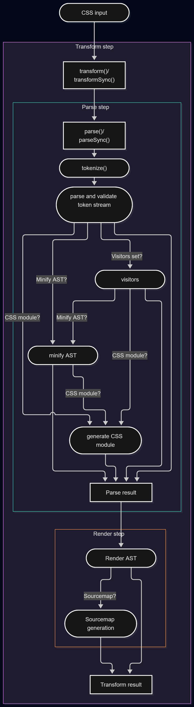

[](https://tbela99.github.io/css-parser/playground/) [](https://www.npmjs.com/package/@tbela99/css-parser) [](https://jsr.io/@tbela99/css-parser) [](https://github.com/tbela99/css-parser/actions) [](https://tbela99.github.io/css-parser/docs) [](https://www.npmjs.com/package/@tbela99/css-parser) [](https://www.npmjs.com/package/@tbela99/css-parser)

# css-parser

An all-in-one CSS parsing solution for Node.js and the browser, covering parsing, validation, transformation, minification, and AST-based tooling.

The library always fully parses the stylesheet into a structured AST, and token values are exposed as typed data so custom transforms, plugins, and analysis can work with reliable, semantic input instead of raw strings.

## Installation

From npm

```shell
$ npm install @tbela99/css-parser
```

from jsr

```shell
$ deno add @tbela99/css-parser
```

## Features

* **Zero dependencies** — lightweight and easy to integrate into any project.
* **All-in-one CSS parsing solution** covering parsing, validation, transformation, minification, and AST manipulation.
* **Standards-based CSS validation** powered by MDN data.
* **Full CSS Modules support** for modern component-based workflows.
* **Fault-tolerant parsing** that follows the CSS Syntax Module Level 3 specification and always produces a complete, structured parse result.
* **Typed tokens and AST** — parsed CSS is exposed as strongly typed tokens and nodes so plugins and transforms can operate on semantic structures.
* **High-performance minification** with safe optimizations and no unsafe transforms.
* **Advanced color processing** with support for modern color spaces and functions, including `color()`, `lab()`, `lch()`, `oklab()`, `oklch()`, `color-mix()`, `light-dark()`, system colors, and relative colors.
* **Color conversion engine** capable of transforming colors between all supported formats.
* **Automatic CSS nesting generation** from compatible selectors.
* **Source map generation** for easier debugging and development workflows.
* **Shorthand property computation** to reduce output size and improve optimization.
* **Transform function optimization** for more compact CSS output.
* **Math function evaluation**, including `calc()`, `clamp()`, `min()`, `max()`, and related expressions.
* **CSS variable inlining** where values can be safely resolved.
* **Duplicate declaration removal** to eliminate redundant rules.
* **`@import` flattening** to produce self-contained stylesheets.
* **51.5kb** once minified and gzipped.

## Vendor prefix removal
**Vendor prefix cleanup** to modernize generated CSS.

## Syntax lowering
CSS-Parser can transform these modern CSS features into lower-level CSS syntax:
* **Nested CSS transpilation** to legacy-compatible syntax.
* **`if()` function transpilation** for broader browser compatibility.
* **`color-mix()` function conversion** convert new color-mix() syntax to any of the supported colors.
  
## Benchmark

Across all tested datasets, css-parser consistently produces the smallest output among the benchmarked tools, including Lightning CSS, cssnano, csso, clean-css, css-tree, and esbuild. 

The [benchmark](https://tbela99.github.io/css-parser/benchmark/index.html) evaluates minification effectiveness on a diverse set of real-world stylesheets, including Bootstrap 4, Bootstrap 5, Tailwind CSS, Animate.css, Foundation, Font Awesome, Normalize.css, and others.

A sample result:

| File                           | ligthningcss  | CSS Parser    |
| ------------------------------ | ------------- | ------------- |
| tailwind.css - 2380419 bytes   | 1864728 bytes | 1633188 bytes |
| bootstrap-4.css - 200078 bytes | 153616 bytes  | 144571 bytes  |
| bootstrap-5.css - 205481 bytes | 159987 bytes  | 150852 bytes  |

On the [complete benchmark suite](https://tbela99.github.io/css-parser/benchmark/index.html), css-parser generated a total output size of 2,158,698 bytes, compared to 2,494,113 bytes for Lightning CSS and larger outputs for all other tested minifiers. 
While some tools prioritize raw execution speed, css-parser focuses on maximizing compression while preserving stylesheet semantics, resulting in consistently smaller production bundles.

## Minification performance vs execution speed

`css-parser` is designed for maximum minification performance, but the optimal configuration depends on what matters most for your workload.
 
The parser provides settings that let you choose the balance between minification performance and execution speed:

- Minification performance: prioritize the quality and efficiency of the minification process, allowing the parser to perform additional work when generating the minimized output.

- Execution speed: minimize the amount of work performed during parsing and minification to achieve the fastest possible execution time.

However, the available settings allow you to shift the balance toward execution speed when minimizing runtime is more important than performing every available minification optimization.

The example below demonstrates a balanced configuration that improves execution speed by disabling advanced minification features.

```ts

import {transformSync} from "@tbela99/css-parser";

const css = `...`;

const result = transformSync({
                  input: css,
                  minify: false,
                  beautify: false,
                  removeEmpty: true,
                  removeComments: true,
                  convertColor: true,
                  minifyValues: true,
                });

console.debug(result.code);
console.debug(result.stats);
```

Performance vs execution speed comparison


| File:  tailwind.css   | Speed optimization | Minification optimization |
| --------------------- | ------------------ | ------------------------- |
| Size: 2,380,419 bytes | 1,890,835 bytes    | 1,633,188 bytes           |
| Time                  | 129.64 ms          | 266.74 ms                 |
| Size reduction        | -20.6%             | -31.4%                    |

## Playground

Try it [online](https://tbela99.github.io/css-parser/playground/)

## Documentation

- [Installation](https://tbela99.github.io/css-parser/docs/documents/Guide.Getting_started.html#installation)
- [Usage](https://tbela99.github.io/css-parser/docs/documents/Guide.Usage.html)
  - [Parsing CSS](https://tbela99.github.io/css-parser/docs/documents/Guide.Usage.html#parsing)
  - [Parsing files](https://tbela99.github.io/css-parser/docs/documents/Guide.Usage.html#parsing-files)
  - [Parsing streams](https://tbela99.github.io/css-parser/docs/documents/Guide.Usage.html#parsing-from-a-readable-stream)
  - [Rendering AST](https://tbela99.github.io/css-parser/docs/documents/Guide.Usage.html#rendering-ast)
  - [Transform](https://tbela99.github.io/css-parser/docs/documents/Guide.Usage.html#transform)
- [Validation](https://tbela99.github.io/css-parser/docs/documents/Guide.Validation.html)
- [CSS Modules](https://tbela99.github.io/css-parser/docs/documents/Guide.CSS_Modules.html)
- [Minification](https://tbela99.github.io/css-parser/docs/documents/Guide.Minification.html)
- [Custom Transform](https://tbela99.github.io/css-parser/docs/documents/Guide.Custom_Transform.html)
- [Sourcemap](https://tbela99.github.io/css-parser/docs/documents/Guide.Sourcemap.html)
- [Plugins API](https://tbela99.github.io/css-parser/docs/documents/Guide.Plugins_API.html)
- [Syntax Lowering](https://tbela99.github.io/css-parser/docs/documents/Guide.Syntax_Lowering.html)
- [Prefix Removal](https://tbela99.github.io/css-parser/docs/documents/Guide.Prefix_Removal.html)
- [Ast Manipulation](https://tbela99.github.io/css-parser/docs/documents/Guide.Ast_Manipulation.html)
- [Utility Functions](https://tbela99.github.io/css-parser/docs/documents/Guide.Utility_Functions.html)
  
## AST

Ast nodes and value tokens are allocated in an arena (`AstArena`) and referenced by their id (a number). The node data is stored
column-wise in typed arrays (structure of arrays) and is read / written through the arena. The parser does not allocate
node or token objects:

```ts
import {parse, render, EnumToken} from '@tbela99/css-parser';

const {arena, ast} = await parse(`.foo { color: red }`);
const rule = arena.firstChild[ast];
const declaration = arena.firstChild[rule];

console.log(arena.dataTypes[rule] == EnumToken.RuleNodeType, arena.getSelector(rule)); // true '.foo'
console.log(arena.getName(declaration)); // 'color'
console.log(arena.tokens(declaration).map((token) => [EnumToken[arena.dataTypes[token]], arena.str(token)])); // [['Color', 'red']]
console.log(render(arena, ast).code); // .foo{color:red}
```

### Comment

- `arena.dataTypes[n]`: EnumToken.CommentNodeType
- `arena.getValue(n)`: string, the comment

### StyleSheet

- `arena.dataTypes[n]`: EnumToken.StyleSheetNodeType
- `arena.children(n)`: array of children ids

### Declaration

- `arena.dataTypes[n]`: EnumToken.DeclarationNodeType
- `arena.getName(n)`: string, declaration name
- `arena.tokens(n)`: array of token ids, the declaration value
- `arena.getState(n)`: EnumAstNodeStatus, validation state
- `arena.getErrors(n)`: ErrorDescription[], validation errors

### Rule and KeyframesRule

- `arena.dataTypes[n]`: EnumToken.RuleNodeType or EnumToken.KeyframesRuleNodeType
- `arena.getSelector(n)`: string, css selector
- `arena.tokens(n)`: array of token ids, the parsed selector
- `arena.children(n)`: array of children ids
- `arena.getState(n)`: EnumAstNodeStatus, validation state
- `arena.getErrors(n)`: ErrorDescription[], validation errors

### AtRule and KeyframesAtRule

- `arena.dataTypes[n]`: EnumToken.AtRuleNodeType or EnumToken.KeyframesAtRuleNodeType
- `arena.getName(n)`: string. AtRule name
- `arena.getValue(n)`: rule prelude
- `arena.tokens(n)`: array of token ids, the parsed prelude
- `arena.children(n)`: array of children ids (at-rules with a block)
- `arena.getState(n)`: EnumAstNodeStatus, validation state
- `arena.getErrors(n)`: ErrorDescription[], validation errors

### Workers

The arena can be moved to a worker (and back) without copying the node data:

```ts
// main thread
const [properties, transferables] = AstArena.toTransferableArenaObject(result.arena);
worker.postMessage({ast: result.ast, properties, transferables}, transferables);

// worker
const arena = AstArena.fromTransferableArenaObjects(event.data.properties, event.data.transferables);
console.log(render(arena, event.data.ast).code);
```

See [Ast Manipulation](https://tbela99.github.io/css-parser/docs/documents/Guide.Ast_Manipulation.html).

## Sourcemap

- [x] Sourcemap generation
- [x] Input sourcemap: when the input CSS comes from another tool, you can pass the sourcemap content to link the generated CSS positions to the original files.

## Computed shorthands properties

- [ ] ~all~
- [x] animation
- [x] background
- [x] border
- [ ] border-block-end
- [ ] border-block-start
- [x] border-bottom
- [x] border-color
- [ ] border-image
- [ ] border-inline-end
- [ ] border-inline-start
- [x] border-left
- [x] border-radius
- [x] border-right
- [x] border-style
- [x] border-top
- [x] border-width
- [x] column-rule
- [x] columns
- [x] container
- [ ] contain-intrinsic-size
- [x] flex
- [x] flex-flow
- [x] font
- [ ] font-synthesis
- [ ] font-variant
- [x] gap
- [ ] grid
- [x] grid-area
- [x] grid-column
- [x] grid-row
- [x] grid-template
- [x] inset
- [x] list-style
- [x] margin
- [ ] mask
- [ ] offset
- [x] outline
- [x] overflow
- [x] padding
- [ ] place-content
- [ ] place-items
- [ ] place-self
- [x] scroll-margin
- [x] scroll-padding
- [x] scroll-timeline
- [x] text-decoration
- [x] text-emphasis
- [x] transition

## Performance

- [x] Bundle file referenced by the @import statement.

# Architecture

