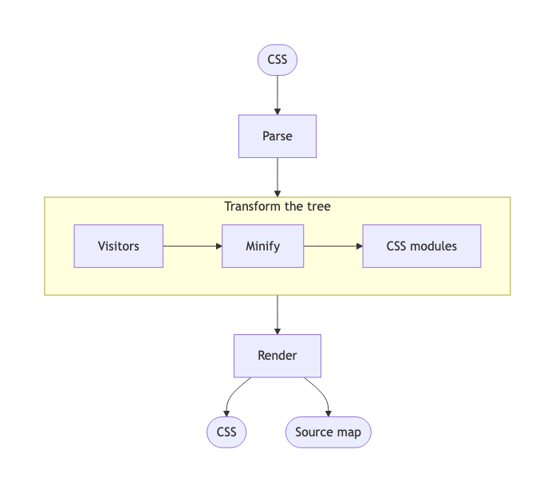

[](https://tbela99.github.io/css-parser/playground/) [](https://www.npmjs.com/package/@tbela99/css-parser) [](https://jsr.io/@tbela99/css-parser) [](https://github.com/tbela99/css-parser/actions) [](https://tbela99.github.io/css-parser/docs) [](https://www.npmjs.com/package/@tbela99/css-parser) [](https://www.npmjs.com/package/@tbela99/css-parser)

# css-parser

A zero-allocation, high-performance CSS processing engine for Node.js and the browser, combining parsing, validation, transformation, minification, and AST-based tooling in a single solution.

Every stylesheet is fully parsed into a structured AST, with token values represented as typed data. This provides a reliable semantic foundation for custom transformations, plugin development, and advanced stylesheet analysis without relying on raw string manipulation.
 
> [!NOTE]
> Version 2.2.0 has been rewritten to use arena memory for AST nodes and tokens, improving memory usage and performance. On the Tailwind CSS parsing and validation workload, runtime is **59% faster than v1.8.2** while using less memory.<br>
This major release also introduces breaking changes and removes deprecated features. See the [migration guide](https://tbela99.github.io/css-parser/docs/documents/Guide.Migration.html) for details.

## Installation

From npm

```shell
$ npm install @tbela99/css-parser
```

from jsr

```shell
$ deno add @tbela99/css-parser
```

### Native and WebAssembly builds

The library is also ported to Rust, in two builds with the same API and the same output as the TypeScript library,
faster:

| Package | Runs in | Speed |
|---------|---------|-------|
| [`@tbela99/rust-css-parser-napi`](https://tbela99.github.io/css-parser/docs/documents/Guide.Native_build_%28N-API%29.html) | Node.js on macOS and Linux | up to 2.1x faster than TypeScript |
| [`@tbela99/rust-css-parser-wasm`](https://tbela99.github.io/css-parser/docs/documents/Guide.WebAssembly_build.html) | Node.js and the browsers | up to 1.9x faster than TypeScript |

The WebAssembly build is **only 2.5 MB (865 KB gzipped)**, with no native dependency: it runs anywhere WebAssembly
runs. The native build is compiled from its Rust sources when it is installed (requires the
[Rust toolchain](https://rustup.rs)).

```shell
$ npm install @tbela99/rust-css-parser-wasm
$ npm install @tbela99/rust-css-parser-napi
```

Switching build only changes the import:

```javascript
import {transformSync} from '@tbela99/rust-css-parser-wasm';

const result = transformSync('.a { color: #ff0000; width: calc(100px + 20px) }');
console.debug(result.code); // .a{color:red;width:120px}
```

It is also available as a Rust library on crates.io: [`rust-css-parser`](https://crates.io/crates/rust-css-parser)
(`cargo add rust-css-parser`), see [Rust crate](https://tbela99.github.io/css-parser/docs/documents/Guide.Rust_crate.html).

## Features

* **Zero dependencies** — lightweight and easy to integrate into any project.
* **All-in-one CSS parsing solution** covering parsing, validation, transformation, minification, and AST manipulation.
* **Standards-based CSS validation** powered by the W3C specification definitions ([@webref/css](https://github.com/w3c/webref/tree/main/packages/css)).
* **Full CSS Modules support** for modern component-based workflows.
* **Fault-tolerant parsing** that follows the CSS Syntax Module Level 3 specification and always produces a complete, structured parse result.
* **Typed tokens and AST** — parsed CSS is exposed as strongly typed tokens and nodes so plugins and transforms can operate on semantic structures.
* **High-performance minification** with safe optimizations and no unsafe transforms.
* **Advanced color processing** with support for modern color spaces and functions, including `color()`, `lab()`, `lch()`, `oklab()`, `oklch()`, `color-mix()`, `light-dark()`, system colors, and relative colors.
* **Color conversion engine** capable of transforming colors between all supported formats.
* **Automatic CSS nesting generation** from compatible selectors.
* **Source map generation** for easier debugging and development workflows.
* **Shorthand property computation** to reduce output size and improve optimization.
* **Transform function optimization** for more compact CSS output.
* **Math function evaluation**, including `calc()`, `clamp()`, `min()`, `max()`, and related expressions.
* **CSS variable inlining** where values can be safely resolved.
* **Duplicate declaration removal** to eliminate redundant rules.
* **`@import` flattening** to produce self-contained stylesheets.
* **Vendor prefix cleanup** to modernize generated CSS.
* **Binary input** — the css can be a string, an `ArrayBuffer` or an `ArrayBufferView` (utf-8 bytes, `Uint8Array`, `Buffer`): an ASCII or UTF-8 buffer is tokenized from its bytes, without copy or decoding.
* **Experimental**: evaluate @mixin and @function
* **51.5kb** once minified and gzipped.
* **Native and WebAssembly builds** — the same API ported to Rust: an N-API addon for Node.js, and a WebAssembly build of **only 2.5 MB** (865 KB gzipped) for Node.js and the browsers.

## Vendor prefix removal
**Vendor prefix cleanup** to modernize generated CSS.

## Syntax lowering
CSS-Parser can transform these modern CSS features into lower-level CSS syntax:
* **Nested CSS transpilation** to legacy-compatible syntax.
* **`if()` function transpilation** for broader browser compatibility.
* **`color-mix()` function conversion** convert new color-mix() syntax to any of the supported colors.
* **CSS mixins and custom functions evaluation** (experimental, enabled with `{evaluateMixins: true}`) the `@apply` rules are replaced by the mixin body, the custom function calls are replaced by their result.
  
## Benchmark

Across all tested datasets, css-parser consistently produces the smallest output among the benchmarked tools, including Lightning CSS, cssnano, csso, clean-css, css-tree, and esbuild. 

The [benchmark](https://tbela99.github.io/css-parser/benchmark/index.html) evaluates minification effectiveness on a diverse set of real-world stylesheets, including Bootstrap 4, Bootstrap 5, Tailwind CSS, Animate.css, Foundation, Font Awesome, Normalize.css, and others.

A sample result:

| File                           | ligthningcss  | CSS Parser    |
| ------------------------------ | ------------- | ------------- |
| tailwind.css - 2380419 bytes   | 1864728 bytes | 1624148 bytes |
| bootstrap-4.css - 200078 bytes | 153616 bytes  | 144391 bytes  |
| bootstrap-5.css - 205484 bytes | 159987 bytes  | 150764 bytes  |

On the [complete benchmark suite](https://tbela99.github.io/css-parser/benchmark/index.html), css-parser generated a total output size of 2,157,410 bytes, compared to 2,426,883 bytes for Lightning CSS and larger outputs for all other tested minifiers. 
While some tools prioritize raw execution speed, css-parser focuses on maximizing compression while preserving stylesheet semantics, resulting in consistently smaller production bundles.

## Minification performance vs execution speed

`css-parser` is designed for maximum minification performance, but the optimal configuration depends on what matters most for your workload.
 
The parser provides settings that let you choose the balance between minification performance and execution speed:

- Minification performance: prioritize the quality and efficiency of the minification process, allowing the parser to perform additional work when generating the minimized output.

- Execution speed: minimize the amount of work performed during parsing and minification to achieve the fastest possible execution time.

However, the available settings allow you to shift the balance toward execution speed when minimizing runtime is more important than performing every available minification optimization.

The example below demonstrates a balanced configuration that improves execution speed by disabling the expensive minification features and keeping the inexpensive ones.

```ts

import {transformSync} from "@tbela99/css-parser";

const css = `...`;

// the ast is not minified, the rules are not merged
const result = transformSync(css, {fastMode: true});

console.debug(result.code);
console.debug(result.stats);
```

`fastMode: true` sets `minify: false` and `mergeRules: MergeRulesEnum.None`: the ast is not minified, the rules are not
merged, the values are minified when they are rendered. An option given explicitly takes precedence: `{fastMode: true,
minify: true}` minifies the ast without merging the rules.

Compared with lightningcss and esbuild: the 12 files of the [benchmark](https://tbela99.github.io/css-parser/benchmark/index.html)
(3.0 MB), total of the median times and of the output sizes (Apple M2, Node.js 27). "fastMode" is the setting of
the example above, "default settings" are the defaults (the safe minifications). The
[native](https://tbela99.github.io/css-parser/docs/documents/Guide.Native_build_%28N-API%29.html) and the
[WebAssembly](https://tbela99.github.io/css-parser/docs/documents/Guide.WebAssembly_build.html) builds produce the
same output as the TypeScript library, faster.

| Library | Time | Output | Output vs lightningcss |
|---------|-----:|-------:|-----------------------:|
| N-API, fastMode | 55.8 ms | 2413 KB | +1.8% |
| lightningcss | 59.2 ms | 2370 KB |  |
| WebAssembly, fastMode | 68.4 ms | 2413 KB | +1.8% |
| esbuild | 119.8 ms | 2487 KB | +4.9% |
| N-API, default settings | 124.4 ms | 2107 KB | **-11.1%** |
| TypeScript, fastMode | 136.1 ms | 2413 KB | +1.8% |
| WebAssembly, default settings | 142.0 ms | 2107 KB | **-11.1%** |
| TypeScript, default settings | 243.9 ms | 2107 KB | **-11.1%** |

- With the default settings, the output is 11.1% smaller than lightningcss. Lightningcss is about 2.1 times faster
  than the N-API build.
- With `fastMode`, the N-API build is faster than lightningcss (6% faster), and its output is 1.8% larger. It is
  smaller than the output of esbuild.

See [Performance](https://tbela99.github.io/css-parser/docs/documents/Guide.Performance.html) for the details.

## Playground

Try it [online](https://tbela99.github.io/css-parser/playground/)

## Documentation

- [Installation](https://tbela99.github.io/css-parser/docs/documents/Guide.Getting_started.html#installation)
- [Usage](https://tbela99.github.io/css-parser/docs/documents/Guide.Usage.html)
  - [Parsing CSS](https://tbela99.github.io/css-parser/docs/documents/Guide.Usage.html#parsing)
  - [Parsing files](https://tbela99.github.io/css-parser/docs/documents/Guide.Usage.html#parsing-files)
  - [Parsing streams](https://tbela99.github.io/css-parser/docs/documents/Guide.Usage.html#parsing-from-a-readable-stream)
  - [Rendering AST](https://tbela99.github.io/css-parser/docs/documents/Guide.Usage.html#rendering-ast)
  - [Transform](https://tbela99.github.io/css-parser/docs/documents/Guide.Usage.html#transform)
- [Validation](https://tbela99.github.io/css-parser/docs/documents/Guide.Validation.html)
- [CSS Modules](https://tbela99.github.io/css-parser/docs/documents/Guide.CSS_Modules.html)
- [Minification](https://tbela99.github.io/css-parser/docs/documents/Guide.Minification.html)
- [Custom Transform](https://tbela99.github.io/css-parser/docs/documents/Guide.Custom_Transform.html)
- [Sourcemap](https://tbela99.github.io/css-parser/docs/documents/Guide.Sourcemap.html)
- [Plugins API](https://tbela99.github.io/css-parser/docs/documents/Guide.Plugins_API.html)
- [Syntax Lowering](https://tbela99.github.io/css-parser/docs/documents/Guide.Syntax_Lowering.html)
- [Prefix Removal](https://tbela99.github.io/css-parser/docs/documents/Guide.Prefix_Removal.html)
- [Ast Manipulation](https://tbela99.github.io/css-parser/docs/documents/Guide.Ast_Manipulation.html)
- [Arena Memory](https://tbela99.github.io/css-parser/docs/documents/Guide.Arena_Memory.html)
- [Utility Functions](https://tbela99.github.io/css-parser/docs/documents/Guide.Utility_Functions.html)
- [Migration to 2.0](https://tbela99.github.io/css-parser/docs/documents/Guide.Migration.html)
  
## AST

Ast nodes and value tokens are allocated in an arena (`AstArena`) and referenced by their id (a number). The node data is stored
column-wise in typed arrays (structure of arrays) and is read / written through the arena. The parser does not allocate
node or token objects:

```ts
import {parse, render, EnumToken} from '@tbela99/css-parser';

const {arena, ast} = await parse(`.foo { color: red }`);
const rule = arena.getFirstChild(ast);
const declaration = arena.getFirstChild(rule);

console.log(arena.getType(rule) == EnumToken.RuleNodeType, arena.getSelector(rule)); // true '.foo'
console.log(arena.getName(declaration)); // 'color'
console.log(arena.tokens(declaration).map((token) => [EnumToken[arena.getType(token)], arena.str(token)])); // [['Color', 'red']]
console.log(render(arena, ast).code); // .foo{color:red}
```

### Comment

- `arena.getType(n)`: EnumToken.CommentNodeType
- `arena.getValue(n)`: string, the comment

### StyleSheet

- `arena.getType(n)`: EnumToken.StyleSheetNodeType
- `arena.children(n)`: array of children ids

### Declaration

- `arena.getType(n)`: EnumToken.DeclarationNodeType
- `arena.getName(n)`: string, declaration name
- `arena.tokens(n)`: array of token ids, the declaration value
- `arena.getState(n)`: EnumAstNodeStatus, validation state
- `arena.getErrors(n)`: ErrorDescription[], validation errors

### Rule and KeyframesRule

- `arena.getType(n)`: EnumToken.RuleNodeType or EnumToken.KeyframesRuleNodeType
- `arena.getSelector(n)`: string, css selector
- `arena.tokens(n)`: array of token ids, the parsed selector
- `arena.children(n)`: array of children ids
- `arena.getState(n)`: EnumAstNodeStatus, validation state
- `arena.getErrors(n)`: ErrorDescription[], validation errors

### AtRule and KeyframesAtRule

- `arena.getType(n)`: EnumToken.AtRuleNodeType or EnumToken.KeyframesAtRuleNodeType
- `arena.getName(n)`: string. AtRule name
- `arena.getValue(n)`: rule prelude
- `arena.tokens(n)`: array of token ids, the parsed prelude
- `arena.children(n)`: array of children ids (at-rules with a block)
- `arena.getState(n)`: EnumAstNodeStatus, validation state
- `arena.getErrors(n)`: ErrorDescription[], validation errors

### Object views

`arena.toObject(id)` returns an object view of a node or a token (`AstArenaNode`): its properties (`typ`, `nam`, `sel`,
`val`, `chi`, `tokens`, `loc`, `state`, `errors`, `parent`, ...) are getters and setters that read and write the arena.
The view only holds the arena and the node id (`view[ARENAID]`). Importing a view of the same arena is a noop:

```ts
const rule = arena.toObject(arena.getFirstChild(ast));

rule.sel = '.bar';
rule.chi[0].nam = 'background-color';

// the returned arrays are frozen: assign the property to modify the arena
rule.chi = [...rule.chi, {typ: EnumToken.DeclarationNodeType, nam: 'width', val: [{typ: EnumToken.LengthTokenType, val: 3, unit: 'px'}]}];

console.log(arena.fromObject(rule) == rule[ARENAID]); // true: nothing is copied
console.log(JSON.stringify(rule)); // deep plain copy
```

### Traversal and visitors

The traversal and search functions are methods of the arena: `arena.walk()`, `arena.walkValues()`, `arena.find()`,
`arena.findAll()`, `arena.findLast()`, `arena.findByValue()`, `arena.findValue()`. They return node ids. Their callbacks,
like the visitors, are called with the arena and the node id: everything else is read from the arena.

```ts
for (const node of arena.walk(ast)) {

    console.log(EnumToken[arena.getType(node)], arena.getParent(node));
}

const result = await transform(css, {
    visitor: {

        Declaration(arena: AstArena, id: number) {

            const node = arena.toObject(id);

            if (node.nam == 'height') {

                node.nam = 'width';
            }
        }
    }
});
```

A visitor returns nothing to keep the node, or an object or a node id (or an array of objects and node ids) to replace it.

### Arena memory

The arena never frees memory by itself: detached nodes keep their memory and their ids stay valid. A long-lived arena
can be compacted. `compact()` and `trim()` renumber the nodes and return the mapping of the old ids to the new ids:

```ts
console.log(arena.getCapacity(), arena.getLastId(), arena.getStringCount()); // capacity, last allocated id, interned strings

arena.mark(node);                          // mark a node to be released later
const mapping = arena.trim(result.errors); // release the marked nodes, drop the unreachable nodes, shrink the columns
const newId = mapping[oldId];              // 0 when the node has been dropped
```

See [Arena Memory](https://tbela99.github.io/css-parser/docs/documents/Guide.Arena_Memory.html).

### Workers

The arena can be moved to a worker (and back) without copying the node data:

```ts
// main thread
const [properties, transferables] = AstArena.toTransferableArenaObject(result.arena);
worker.postMessage({ast: result.ast, properties, transferables}, transferables);

// worker
const arena = AstArena.fromTransferableArenaObjects(event.data.properties, event.data.transferables);
console.log(render(arena, event.data.ast).code);
```

See [Ast Manipulation](https://tbela99.github.io/css-parser/docs/documents/Guide.Ast_Manipulation.html).

## Sourcemap

- [x] Sourcemap generation
- [x] Input sourcemap: when the input CSS comes from another tool, you can pass the sourcemap content to link the generated CSS positions to the original files.

## Computed shorthands properties

- [ ] ~all~
- [x] animation
- [x] background
- [x] border
- [ ] border-block-end
- [ ] border-block-start
- [x] border-bottom
- [x] border-color
- [ ] border-image
- [ ] border-inline-end
- [ ] border-inline-start
- [x] border-left
- [x] border-radius
- [x] border-right
- [x] border-style
- [x] border-top
- [x] border-width
- [x] column-rule
- [x] columns
- [x] container
- [ ] contain-intrinsic-size
- [x] flex
- [x] flex-flow
- [x] font
- [ ] font-synthesis
- [ ] font-variant
- [x] gap
- [ ] grid
- [x] grid-area
- [x] grid-column
- [x] grid-row
- [x] grid-template
- [x] inset
- [x] list-style
- [x] margin
- [x] margin-block
- [x] margin-inline
- [ ] mask
- [ ] offset
- [x] outline
- [x] overflow
- [x] padding
- [x] padding-block
- [x] padding-inline
- [ ] place-content
- [ ] place-items
- [ ] place-self
- [x] scroll-margin
- [x] scroll-padding
- [x] scroll-timeline
- [x] text-decoration
- [x] text-emphasis
- [x] transition

## Performance

- [x] Bundle file referenced by the @import statement.

# Architecture

