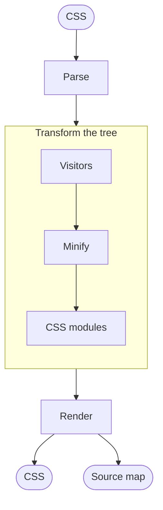

# CSS parser architecture

The library works in two steps: it **parses** the CSS into a tree (the AST), then **renders** the tree back into CSS.
`transform()` runs both steps, `parse()` and `render()` run each step on its own.

## Parse

The input can be a string, an `ArrayBuffer` (or a `Uint8Array`) or a `ReadableStream` (see
[Usage](./usage.md#parsing)). A stream is parsed while it is read: the parser waits for the next chunk when the
tokenizer reaches the end of the CSS received so far.

The tokenizer reads the bytes of an ASCII or UTF-8 input, without copy or decoding: the positions of the tokens are
byte offsets, the locations of the nodes, the columns of the errors and of the source maps, and `stats.bytesIn` are
converted to UTF-16 offsets (the offsets in a JavaScript string). The input that is not valid UTF-8, that contains
U+2028, U+2029 or U+212A, or that is mostly not ASCII, and the streams, are decoded to UTF-16 code units.

The parser reads the CSS and builds a tree of rules, at-rules and declarations. It is fault-tolerant, like a browser:
it always produces a tree. What is invalid is dropped and reported in `errors`, the rest is kept.

With `resolveImport`, the stylesheets of the `@import` rules are loaded and included in the tree.

## Transform the tree

Once the tree is built, these features run, each one enabled by an option:

- **Mixins** (`evaluateMixins`): `@apply` and the custom functions are replaced by their result
- **Nesting** (`expandNestingRules`): the nested rules are turned into flat rules
- **Plugins** (`visitor`): your [plugins](./plugins.md) read and change the tree
- **Minification** (`minify`): the rules, the declarations and the values are made shorter (see
  [Minification](./minification.md))
- **CSS modules** (`module`): the class names are made unique (see [CSS Modules](./css-module.md))

## Render

The renderer turns the tree back into CSS, minified or readable (`beautify`), with a
[source map](./sourcemap.md) if you ask for one.

## The tree

The tree is stored in an [arena](./arena.md): a compact structure where each node is a number. This keeps the parser
fast and the memory usage low. You can still work with the nodes as plain objects when it is more convenient.

## Three builds

The library is available as TypeScript, as a [native addon](./native.md) for Node.js and as
[WebAssembly](./wasm.md). The native and WebAssembly builds are written in Rust, they follow the same steps and produce
the same output, faster. See [Performance](./performance.md).

------
[← Usage](./usage.md) | [Validation →](./validation.md)
