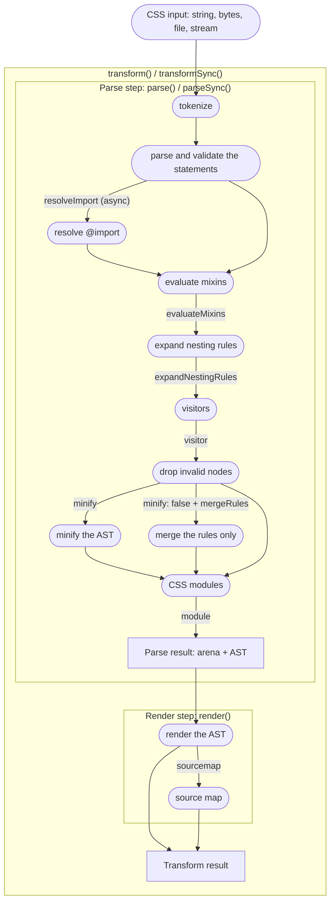

# CSS parser architecture

`transform()` runs two steps: the **parse step** turns the CSS into an AST stored in an [arena](./arena.md), the
**render step** turns the AST back into CSS. `parse()` and `render()` run each step on its own.

The steps of the parse step run in this order. A step whose option is not set is skipped.

## Input and tokenizer

The input is a string, UTF-8 bytes (`ArrayBuffer`, `Uint8Array`, `Buffer`), a file or a readable stream (see
[Usage](./usage.md#parsing)). The tokenizer implements the [CSS Syntax Module Level 3](https://www.w3.org/TR/css-syntax-3/)
tokenization. It reads the code units of the input in place: an ASCII buffer is tokenized without being copied, and
the strings of the tokens are ranges of the input until they are read.

A stream is read to its end, then tokenized. The parser reads the tokens one at a time from the tokenizer and
builds the statements as it goes.

## Parse and validation

The tokens are grouped into statements: rules, at-rules and declarations. Each statement is parsed into AST nodes,
then validated:

- the selectors of the rules and the preludes of the at-rules are always validated
- the declarations are validated against the syntax of their property with `validation: true` (see
  [Validation](./validation.md))

The parser is fault-tolerant: it always produces an AST. The nodes that are invalid, malformed or not allowed where
they are are dropped and reported in `errors`. The unknown nodes are kept by default (`lenient: true`), they are dropped
with `lenient: false`.

## The arena

The AST is stored in an [arena](./arena.md): the nodes and the tokens are integer ids, their data (type, name, value,
children, location, ...) is stored in typed arrays, one per field, and the strings are interned. The parse result is
`{arena, ast}`: `ast` is the id of the stylesheet node. The arena methods read and modify the AST without creating
objects; `arena.toObject(id)` returns an object view of a node when it is more convenient.

## Imports

With `resolveImport: true`, `parse()` and `transform()` load the stylesheets of the `@import` rules with the `load()`
option, in parallel. Each stylesheet is parsed into the same arena and its nodes replace the `@import` rule. The
synchronous functions do not resolve the imports (see
[Difference between sync and async APIs](./usage.md#difference-between-sync-and-async-apis)).

## After the parse

Once the stylesheet is parsed, these steps transform the AST, in this order:

1. **Mixins** (`evaluateMixins`, experimental): the `@apply` rules are replaced by the body of their `@mixin`, the
   custom function calls by their result (see [Syntax Lowering](./syntax-lowering.md)). The mixins are evaluated before
   the nesting rules are expanded: the body of a mixin is nested in the rule it is applied to.
2. **Nesting** (`expandNestingRules`): the nested rules are expanded into flat rules.
3. **Visitors** (`visitor`): the handlers of the [plugins](./plugins.md) are called for the nodes and the tokens they
   subscribe to.
4. **Invalid nodes**: the invalid, malformed and disallowed nodes are dropped, the unknown nodes are kept unless
   `lenient` is `false`.
5. **Minification** (`minify`, default `true`): the AST is minified, see below. With `minify: false`, `mergeRules`
   (`MergeRulesEnum.Identical` or `MergeRulesEnum.All`) runs the rule merge of the minifier only: this is the
   [fast mode](./performance.md#minification-vs-execution-speed).
6. **CSS modules** (`module`): the names are scoped and the mapping is generated (see [CSS Modules](./css-module.md)).

## The minifier

The minifier visits the AST once per pass (`pass`, default `1`). Each node is minified, then compared with the node
that precedes it:

- the adjacent rules that have the same selector are merged, so are the at-rules that have the same name and prelude
  (`@font-face` is never merged); of the `@keyframes` that have the same name, the last one is kept
- the adjacent rules that share declarations are merged when the output is smaller (`mergeRules`): the shared
  declarations move into a rule with both selectors. The rules that have the same declarations are merged without
  computing the size of the output
- the selectors are optimized (`optimizeSelectors`): the redundant selectors are removed, the selectors are factored with
  `:is()`
- the rules are nested (`nestingRules`)

The other minifications are features, each enabled by an option:

| Feature | Option | Default |
|---------|--------|---------|
| shorthand properties, duplicate declarations | `computeShorthand`, `removeDuplicateDeclarations` | `true` |
| `calc()`, `min()`, `max()`, `clamp()`, ... | `computeCalcExpression` | `true` |
| transform functions | `computeTransform` | `true` |
| CSS variables inlining | `inlineCssVariables` | `false` |
| vendor prefixes removal | `removePrefix` | `false` |
| `if()` expansion | `expandIfSyntax` | `false` |
| mixins and custom functions | `evaluateMixins` | `false` |

The defaults apply the safe minifications. See [Minification](./minification.md) for each of them.

## The render step

`render()` writes the AST into a buffer of UTF-8 bytes, allocated from the size of the input. The values are minified
as they are written (colors, numbers, ...) unless `beautify` is `true`. Identical declarations are rendered once: the
following ones are copied from the first one.

The result holds the bytes in `result.write`: `result.code` decodes them the first time it is read (see
[Render result](./usage.md#render-result)). The [source map](./sourcemap.md) is computed from the rendered output when
`sourcemap` is set.

## Three builds, one pipeline

The [native build](./native.md) and the [WebAssembly build](./wasm.md) are ports of this pipeline to Rust: the
modules of the TypeScript sources have Rust counterparts, and the three builds produce the same output. The JavaScript
API of the Rust builds is a thin layer: a call is encoded in a buffer shared with Rust, and the arena columns are typed
arrays over the memory of Rust, read without copying them. The AST of one build cannot be used with another one.

------
[← Usage](./usage.md) | [Validation →](./validation.md)
